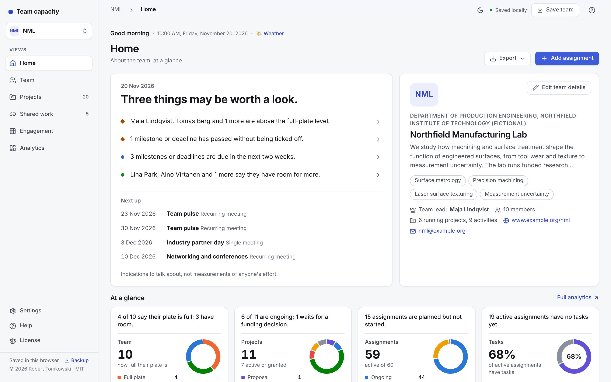
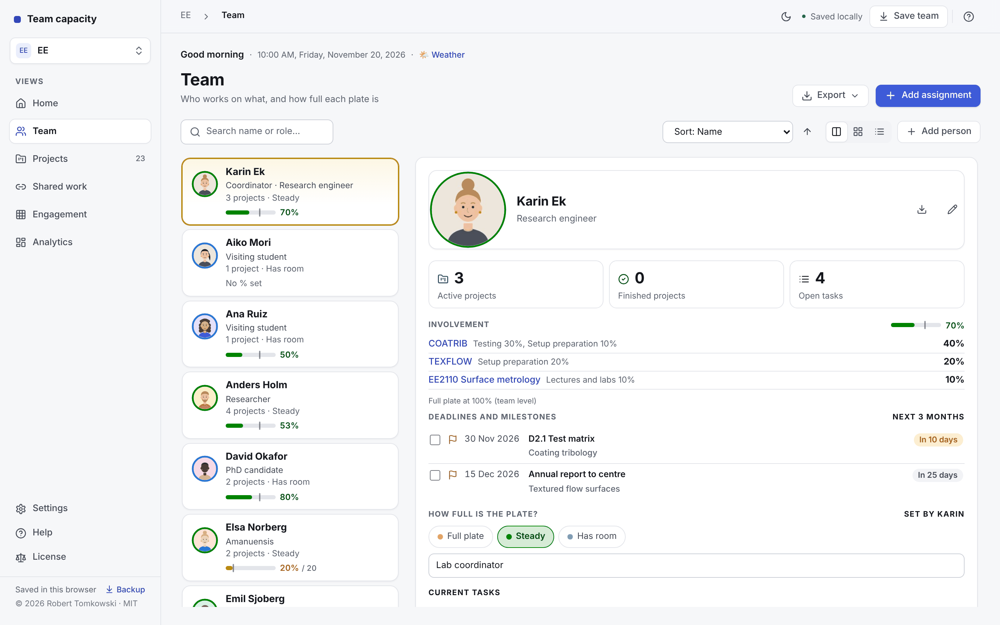
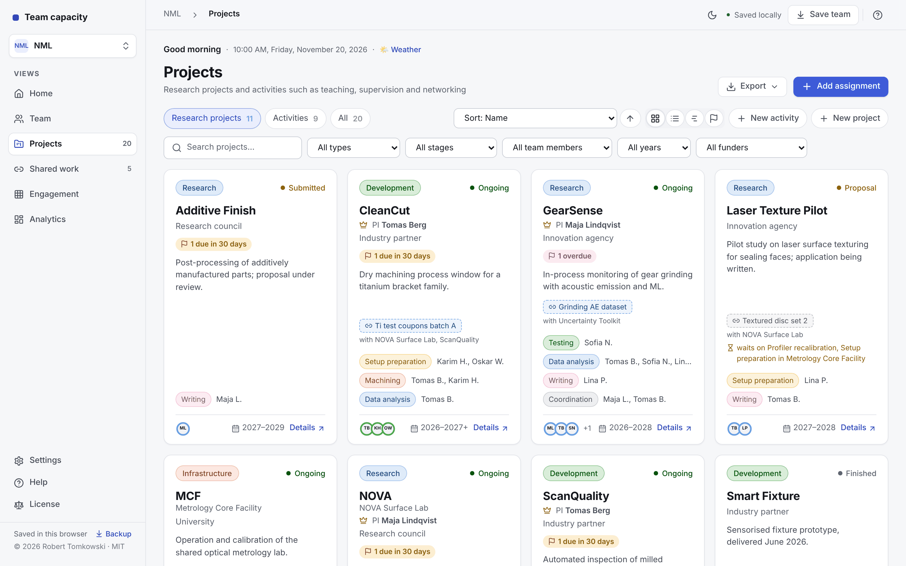
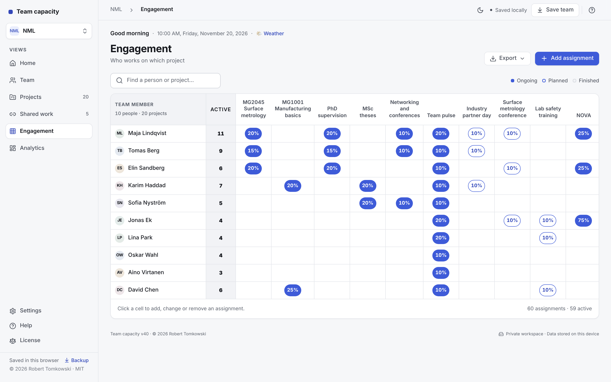
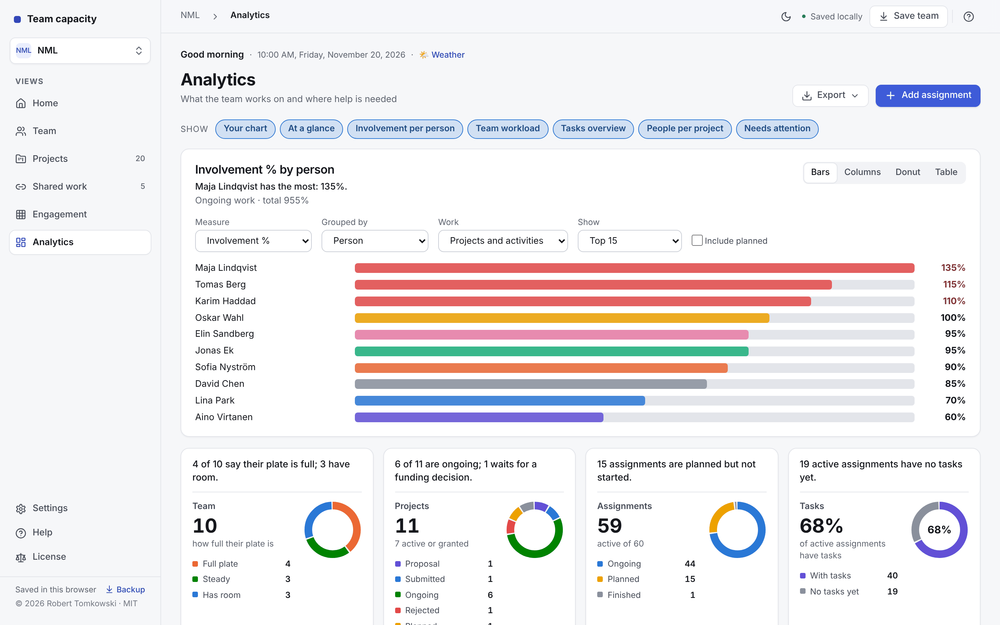
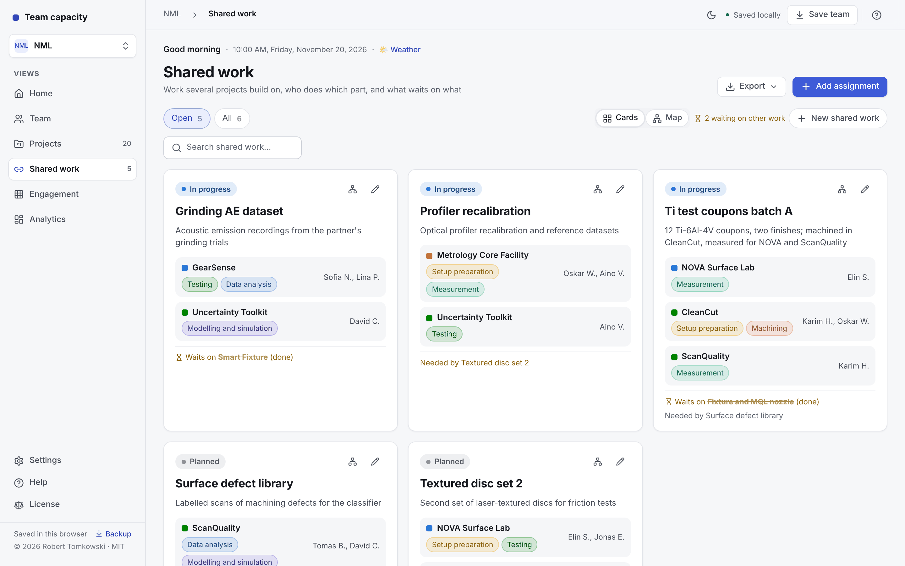
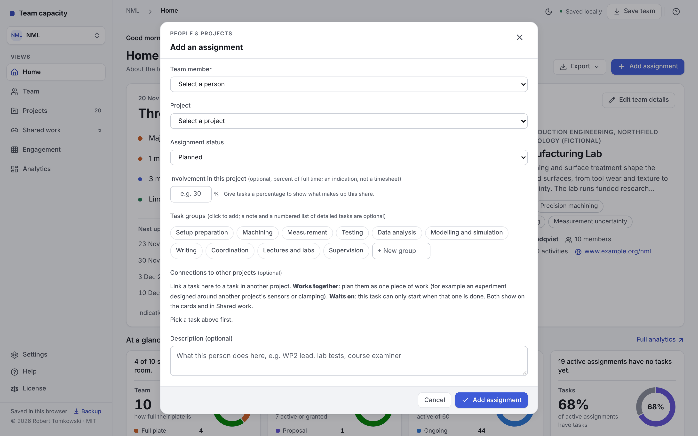

# Team capacity

**See who works on what, and how full everyone's plate is.** Team capacity is a planner for
research groups and other small teams: people, research projects and activities (teaching,
supervision, networking), who is on what, with involvement, tasks, milestones and deadlines. It
is a single HTML file that runs in your browser: no installation, no account, no server, and your
data stays on your own computer.

[](https://github.com/rtomkowski/team-capacity/actions/workflows/tests.yml)
[](LICENSE)

**[Try it online](https://rtomkowski.github.io/team-capacity/app/)** ·
**[User guide](https://rtomkowski.github.io/team-capacity/guide.html)** ·
**[Download](https://rtomkowski.github.io/team-capacity/downloads/Team-capacity.zip)** ·
**[Website](https://rtomkowski.github.io/team-capacity/)**



## Features

- **The team at a glance:** Home says in one sentence what may be worth a look (people above
  their full-plate level, overdue milestones, projects without people, who has room) and lists the
  next dates.
- **Projects and activities as they really are:** research projects from proposal to finished
  with extensions; teaching periods, supervision, recurring meetings and events.
- **Involvement, not hours:** an optional percentage per assignment, task groups with ticked-off
  detailed tasks, and each person's own word on how full their plate is. Weekly hours and a
  capacity planner are there if the team switches them on.
- **Milestones, deadlines and timelines**, with moved dates remembered.
- **Shared work** across projects, with a dependency map of what waits on what.
- **Engagement grid and Analytics** with a takeaway in plain words above every chart.
- **Several teams**, and two fictional demo teams to try things out.
- **Share it your way:** team files in a shared folder that merge colleagues' changes, Excel,
  person cards as PDF, picture or PowerPoint, and timelines for Markwhen.
- Light and dark, two palettes, keyboard shortcuts, WCAG AA contrast.

| | |
|---|---|
|  |  |
|  |  |
|  |  |

## Get started

1. Download [`Team-capacity.zip`](https://rtomkowski.github.io/team-capacity/downloads/Team-capacity.zip)
   and unzip it, or just save [`Team capacity.html`](https://rtomkowski.github.io/team-capacity/downloads/Team%20capacity.html).
2. Double-click `Team capacity.html`. It opens in Chrome, Edge, Firefox, Safari, Arc or Opera.
3. Look around the fictional Northfield demo team, then click the team name and **Create new team**.
4. Click **Save team** now and then and keep the `.json` file in a shared folder. In Chrome and
   Edge the app can auto-save to that file and merge colleagues' changes.

The [user guide](https://rtomkowski.github.io/team-capacity/guide.html) explains everything.

**Privacy:** teams are stored in your browser and in the files you save. The only network request
is the optional weather on Home (off until you pick a place), which sends that place to
Open-Meteo and nothing else. The online version is the same file and never stores your data.

## For developers

React 19, TypeScript and Vite; `vite-plugin-singlefile` inlines everything into one HTML file that
opens from `file://`. Tests use Node's built-in test runner.

```
src/          the app (model.ts: data model and rules; main.tsx and views.tsx: the UI)
tests/        node:test suite (tests/fixtures: an anonymised sample plan)
demo-data/    the fictional demo teams (Northfield, Experimental Engineering) and portraits
docs/         user guide (Markdown), screenshots and website sources
scripts/      screenshots, website build, demo team builders
website/      the GitHub Pages site (built by scripts/build_site.py)
```

```
npm ci                              # Node.js 22.18 or newer
npm run dev                         # development server on 127.0.0.1
npm test                            # the test suite
npm run build                       # dist/index.html, the whole app in one file
node scripts/screenshots.cjs        # screenshots of the demo teams into docs/images (Playwright)
python3 scripts/build_site.py       # website/ with the app, guide, guide PDF and ZIP (pandoc, Playwright)
```

The data model is in `src/model.ts` (`Plan`, file version 1); every field added since the first
version is optional, so older team files open unchanged. See [CHANGELOG.md](CHANGELOG.md) for the
history.

## License

MIT, Copyright (c) 2026 Robert Tomkowski (rtom@kth.se). Developed with the assistance of
Claude Code. See [LICENSE](LICENSE).
