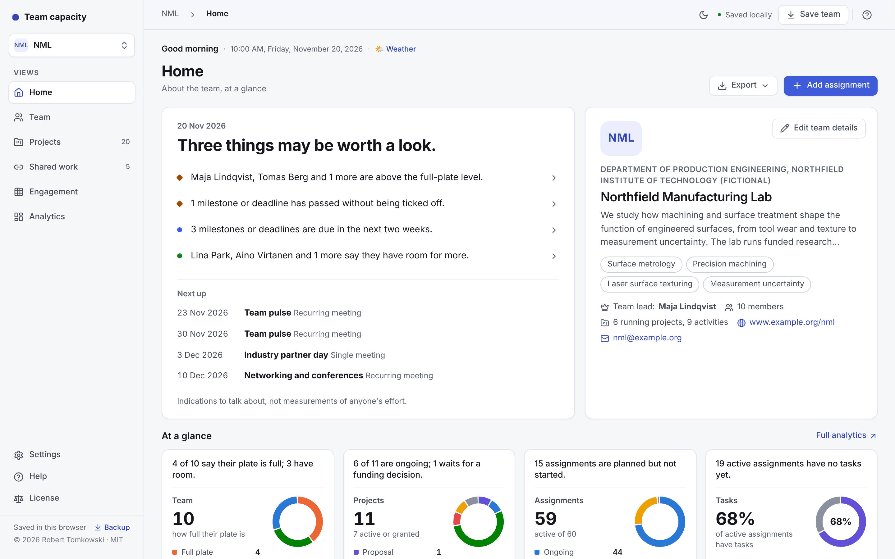
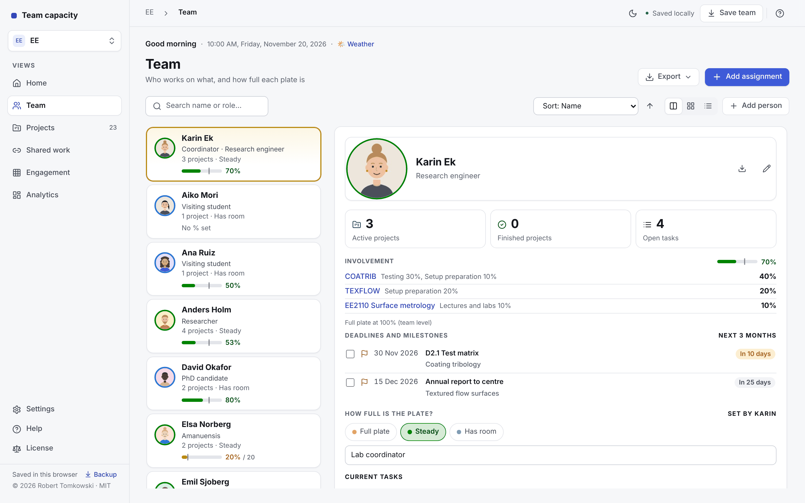
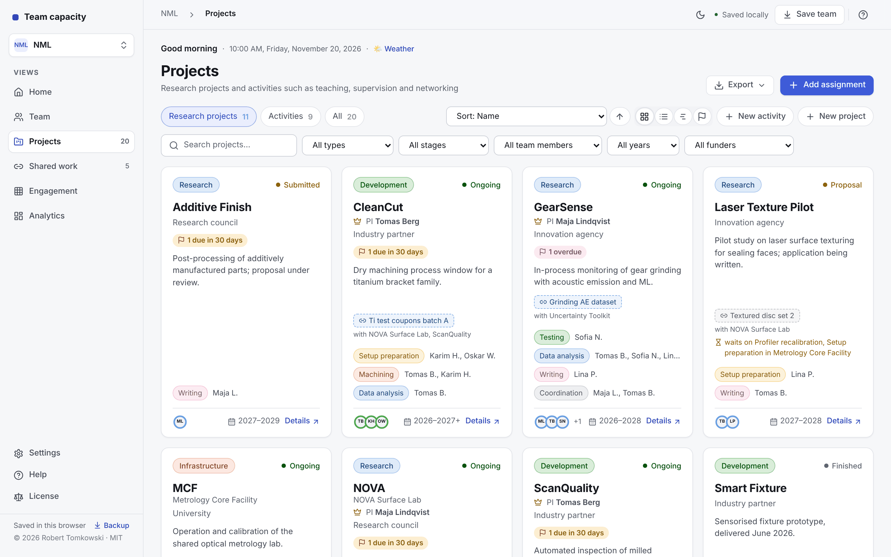
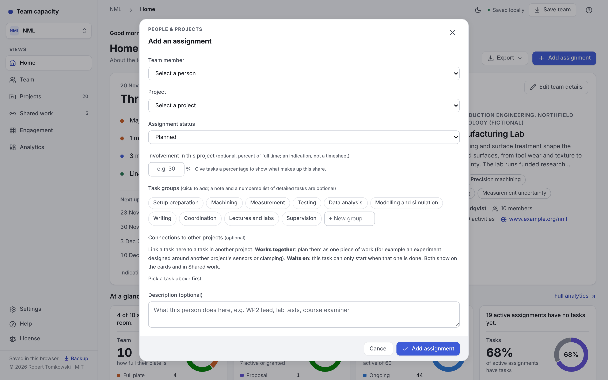
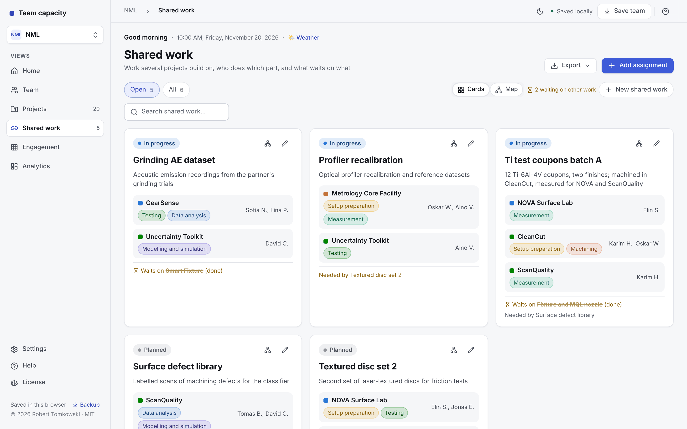
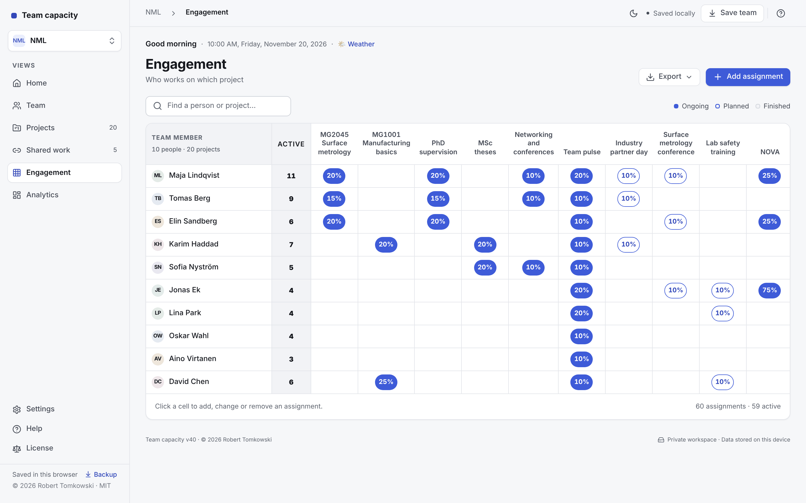
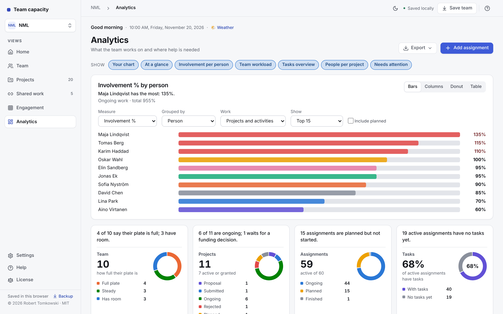
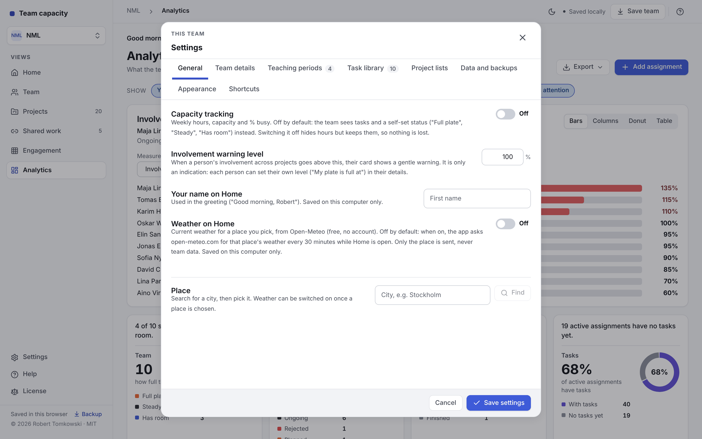

# Team capacity: user guide

**See who works on what, and how full everyone's plate is.** Team capacity is a planner for
research groups and other small teams: people, projects and activities (teaching, supervision,
networking), who is on what, with an optional involvement percentage, tasks, milestones and
deadlines. It gives the team leader and the team the same picture, as a starting point for
conversations rather than a time sheet.

It is one file, `Team capacity.html`, that you open in your web browser. There is nothing to
install, no account and no server. Your teams are saved in the browser on your own computer, and
you share them as files.

## Contents

1. Getting started
2. Teams
3. People
4. Projects and activities
5. Assignments, involvement and tasks
6. Milestones, deadlines and timelines
7. Shared work across projects
8. Engagement and Analytics
9. Settings
10. Saving, sharing and backups
11. Exports
12. Tips and questions

## 1. Getting started

**What you need:** the file `Team capacity.html` and a web browser. **Google Chrome**,
**Microsoft Edge**, Arc or Opera work best, because they can keep writing to a team file in a
shared folder. Safari and Firefox work too, but each save downloads a new copy (see section 10).

1. Download `Team-capacity.zip` from the website and unzip it, or save `Team capacity.html`
   on its own. Put it somewhere you can find again, for example in your team's OneDrive folder.
2. Double-click it. The first time, it opens with **Northfield (demo)**, a fictional team of ten
   people with research projects, courses and meetings, so you can look around straight away.
3. When you are ready, click the team name at the top of the menu and choose **Create new team**
   (empty, or with three example people to replace).
4. Click **Save team** in the top bar now and then, and keep the file in a shared folder so
   colleagues can open it (section 10).

The menu on the left has the pages **Home**, **Team**, **Projects**, **Shared work**,
**Engagement** and **Analytics**, with **Settings**, **Help** and **License** at the bottom.
Press `?` for the keyboard shortcuts, for example `/` to search and `1` to `6` for the pages.
The moon or sun button in the top bar switches between light and dark.

### Indications, not measurements

The numbers in the app (involvement, workload, task counts) are there to start a conversation:
"you look very full, is that right?". They do not measure anyone's effort or productivity, and
weekly hours are switched off unless the team asks for them (section 9).

## 2. Teams

The app can hold several teams side by side, for example your research group and a centre you
coordinate. Click the team name at the top of the menu to:

- **switch** to another team;
- **Create new team**, empty or with example data;
- **Load team from JSON file**: a team file a colleague saved is added next to your teams;
- **Merge a colleague's file** into the team you have open (section 10);
- **Add demo team**: the fictional *Experimental Engineering* team of 24 people with illustrated
  portraits, 13 research projects in two research centres, four courses and guest lectures;
- **remove** a team with the bin button. The app asks first and offers *Download a copy first*;
  the message that follows has **Undo**. The last team cannot be removed.

**Home** shows the team's details (abbreviation, full name, organisation, description, focus
areas, lead, website and email). Fill them in with **Edit team details**. Above them, a short
list says what may be worth a look: people above their full-plate level, milestones that are
overdue or due soon, projects past their end date or without people, and who has room. Each line
links to the place where you can act on it.

## 3. People

**Team** lists everyone, with the team coordinator first in a gold frame. Click a person to see
their card: role, involvement per project, deadlines and milestones in the next three months, how
full their plate is, and their assignments with tasks. Add someone with **Add person** (or `P`).

A person has a name, an optional role, an optional photo (cropped and shrunk to about 15 kB) and
two things that are theirs to say:

- **How full is the plate?** *Full plate*, *Steady* or *Has room*. The person's own word counts:
  someone above the warning level who says *Steady* shows in amber as a question, not in red.
- **My plate is full at**, for example 80% for someone part time or 50% for an industrial PhD
  candidate. Without it the team's warning level applies (Settings, General).

The Team page has three layouts (side by side, big cards and a list) and can be sorted by name,
role or involvement. The download button on a person's card gives their card as a **PDF**,
**Excel** workbook, **picture (PNG)** or **PowerPoint slide** (a picture, or an editable slide
built from text boxes).

## 4. Projects and activities

**Projects** holds two kinds of work, switched with the tabs at the top:

- **Research projects**, which move through stages: *Proposal* (writing), *Submitted*,
  *Granted* or *Rejected*, *Ongoing* and *Finished*, or *Planned* for internal work without an
  application. The edit dialog opens only the dates that matter for the stage: application,
  funding decision, proposed period, contract period with extensions, and closing.
- **Activities**: *Teaching* (one or more teaching periods, weekdays and times, or variable days),
  *Supervision* (a time span), *Networking* (a single meeting, a recurring meeting or an event) and
  *Other*. A recurring meeting can be weekly on chosen days, every 1 to 4 weeks, or monthly.

Every project or activity can have a type, funder, research centre, abbreviation and full title,
a PI (or course responsible, supervisor and so on), a description and its own **task groups**
(Writing, Measurement, Data analysis, ...). Tick **Add the whole team** for things everyone
attends, such as a weekly meeting.

Projects can be shown as **cards** (click one for its overview), a **list** with a *Next
deadline* column, a **timeline** and a **milestones** list. Filter by type, stage, team member,
year, funder or centre, and sort by name, stage, dates or next deadline. Your own types, funders
and stages are set in Settings, Project lists.

**Extensions.** On an ongoing project, *Add extension* sets a new end date with a reason. The
original end is kept, and the dialog offers to move the open milestones and deadlines that sat at
the old end.

## 5. Assignments, involvement and tasks

An **assignment** says that a person works on a project or activity. Add one with
**Add assignment** (or `A`), from a person's card, from a project's overview, or by clicking a
cell on the Engagement page. It has:

- a **status**: *Planned*, *Ongoing* or *Finished*. Only ongoing work counts towards someone's
  involvement, unless you ask for planned work too;
- an optional **involvement** in percent of full time (an indication, not a timesheet);
- **task groups** the person does there, each with an optional percentage and a numbered list of
  **detailed tasks** to tick off (paste a list and it is split into lines);
- an optional description, for example "WP2 lead, lab tests".

If you pick a person and project that already have an assignment, the dialog says so and shows
what would change before it saves.

## 6. Milestones, deadlines and timelines

Any project or activity can have dated points: a **milestone** (something reached, such as "Test
rig ready") or a **deadline** (something due, such as "Mid-term report"). Add them in the project
dialog under *Milestones and deadlines*, and tick them off wherever they are listed: Home, the
project overview, a person's card and the Milestones layout on Projects. When a date changes, the
point remembers it and shows "Moved from ...".

The **timeline** on Projects (and on a person's card) draws each project on a shared year axis
with a red line for today: application writing, waiting for the decision, the proposed period,
the contract period and each extension, plus milestones as diamonds and deadlines as triangles.
Teaching periods, meetings and events are drawn too. *Export to Markwhen* writes the same
timeline as a `.mw` text file for the [Markwhen](https://markwhen.com) editor.

## 7. Shared work across projects

**Shared work** is for work that several projects build on, such as a batch of test coupons
that one project machines and another measures. Each item lists the projects and tasks that work
together on it, the people on those tasks, a status (*Planned*, *In progress*, *Done*) and what it
**waits on**: another shared item, a whole project or one task. You can also connect tasks from the
assignment dialog with *Connect a task*.

The **Map** layout shows each project as a column with its tasks as boxes: a solid line means
the tasks work together, a dashed arrow means one waits on the other. Drag from one box to another
to connect them.

## 8. Engagement and Analytics

**Engagement** is the whole team against every project and activity as a grid. Each cell shows
the involvement (filled for ongoing, outlined for planned, a tick for finished). Click a cell to
add, change or remove an assignment.

**Analytics** collects the charts. The *Show* chips at the top switch each section on or off:
your own chart, the team at a glance, involvement per person, team workload, tasks, people per
project and what needs attention. In **Your chart** you choose a measure (involvement, assignments,
projects, people, task groups, open tasks), how to group it (person, project, type, funder,
stage, role, research centre) and the chart type (bars, columns, donut or a table). Every chart
has a takeaway in plain words above it.

## 9. Settings

**Settings** has these tabs:

- **General:** *Capacity tracking* (weekly hours, capacity and the Capacity page; off by default),
  the *involvement warning level* (100% unless you change it), your name for the greeting on
  Home, and the optional weather.
- **Team details:** the same details as *Edit team details* on Home, plus the team lead and
  coordinator.
- **Teaching periods:** the periods of your academic year (names and dates), used by teaching
  activities. The demo periods are placeholders.
- **Task library:** the task groups offered in assignments.
- **Project lists:** project types, funders and stages, with rename, reorder and hide.
- **Data and backups:** download and load backups, import Excel, auto-save to a file and
  versions set aside while merging (section 10).
- **Appearance:** the *Calm* (cool grey) or *Paper* (warm off-white) palette. Saved per browser.
- **Shortcuts:** change or switch off the keyboard shortcuts. Saved per computer.

**Weather** is the only feature that uses the internet, and it is off until you pick a place.
Then the app asks [Open-Meteo](https://open-meteo.com) (free, no account) for that place's
current weather every 30 minutes. Only the place is sent, never team data.

## 10. Saving, sharing and backups

The app saves every change in the browser you use (IndexedDB), on that computer. That is
convenient but not a backup: clearing the browser's site data, a private window or another
browser starts again with the demo team. So keep files:

- **Save team** (top bar, `Ctrl+S` or `Cmd+S`) downloads the open team as a `.json` file.
- **Export, All teams (JSON)** downloads every team in one file; **Backup** at the bottom of the
  menu does the same.
- To open a file, use **Load team from JSON file** in the team switcher, or Settings, Data and
  backups.

**Working together.** Each person opens the app on their own computer; there is no live server.
To share one team:

1. Put the team's `.json` file in a shared folder, for example OneDrive or Teams.
2. In **Chrome, Edge, Arc or Opera**, turn on Settings, Data and backups, **Auto-save to a file**
   and choose that file. The app saves every few minutes when something changed. Before each save
   it reads the file, and if a colleague saved in the meantime it **merges** their version with
   yours, record by record (person, project, assignment, shared work). After reopening the app,
   click *Resume auto-save* to give permission again.
3. In **Safari and Firefox**, which cannot write to a chosen file, use **Merge a colleague's
   file** to bring in their saved copy.

When the same record was changed on both sides, your version is kept and theirs is set aside
under *Set aside while merging* in Settings, Data and backups, with *Use this version* to take
theirs instead. Nothing is lost silently. Two people editing different fields of the same project
at the same time count as a conflict on that project.

## 11. Exports

| What | Where | Gives |
|---|---|---|
| Team or all teams | Export menu, Save team | `.json` backup that opens in the app |
| Excel workbook | Export menu | A readable engagement sheet and lists, plus the full plan so it can be imported again |
| Person card | Download button on a person's card | PDF (print), Excel, picture (PNG) or PowerPoint slide |
| Timeline | Projects, Timeline layout | Markwhen `.mw` file |

Excel import (Settings, Data and backups) also reads a simple engagement sheet: a header row
starting with *Team member*, one row per person and one column per project, with `x` for ongoing,
`p` for planned and `d` for finished.

## 12. Tips and questions

**Is my data sent anywhere?** No. Teams live in your browser and in the files you save. The
only network request is the optional weather, which sends the chosen place and nothing else. The
online version on the website is the same file; it saves in your browser, never on the website.

**I opened the app and my team is gone.** You are probably in another browser or a private window, or the
browser's site data was cleared. Each browser keeps its own copy. Load your last
saved `.json` file, and turn on auto-save to a file to keep it current.

**Can I track hours?** Yes, switch on *Capacity tracking* in Settings, General. You then set
weekly working hours per person, plan hours per assignment and week, and get a Capacity page.
Planned hours count as tentative, ongoing hours as committed.

**Can people only see their own part?** No. Everyone can see and edit everything; the tool is
built on trust and avoids micro-management. Each person can export their own card.

**Which browsers?** Current Chrome, Edge, Firefox, Safari, Arc and Opera. On phones the app
works for looking things up; editing is easier on a computer.

**Licence.** MIT. Made by Robert Tomkowski (rtom@kth.se), developed with the assistance of
Claude Code. Source: [github.com/rtomkowski/team-capacity](https://github.com/rtomkowski/team-capacity).
